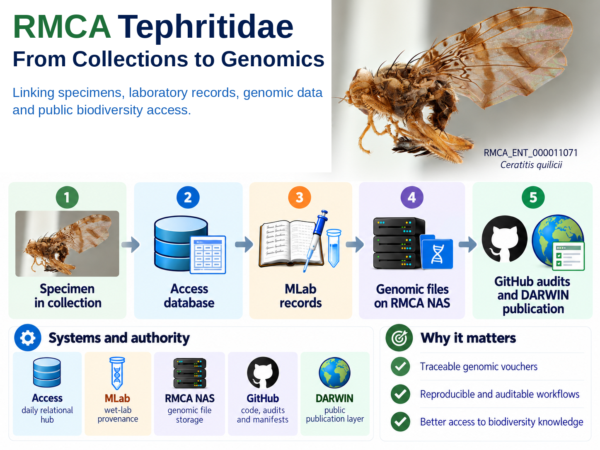

# RMCA Tephritidae: From Collections to Genomics

This repository provides a public overview of an integrated **collections and genomics information system** linking curated voucher specimens, laboratory records, genomic data, reproducible analyses and downstream publication.

## At a glance



Featured specimen: `RMCA_ENT_000011071`, *Ceratitis quilicii*.

## Why it matters

The system is designed to:

- keep genomic data anchored to curated physical vouchers;
- preserve laboratory and analytical provenance;
- make data handling reproducible and auditable;
- support controlled publication of collection information.

## Collaboration and responsible use

Much of the current work on African Tephritidae is developed with African partner institutions and researchers. The system is designed to keep these collaborations visible by linking specimens and genomic resources to projects, partner institutions, permits and transfer or ABS documentation where relevant.

This supports transparent attribution, responsible use and sharing of material and data, and documentation relevant to Nagoya Protocol and national ABS requirements.

## Core lineage

```text
collection lot
    |
individual voucher
    |
optional distinct physical sample
    |
DNA extract
    |
genomic dataset
    |
analysis
    |
publication when appropriate
```

A separate sample is created only when a genuinely distinct physical tissue or body-material object exists. Laboratory rows or labels do not create new biological entities by themselves.

## Systems and authority

No single platform is the complete system.

| System | Role |
| --- | --- |
| **Access** | Daily relational hub for collection and collections-and-genomics links |
| **MLab** | Wet-laboratory source record and provenance |
| **RMCA NAS** | Authoritative storage for raw and important derived genomic files |
| **GitHub** | Versioned code, configuration, manifests and audit evidence |
| **DARWIN** | Downstream institutional publication layer |

Authority is object-specific. A checksum can establish byte identity of a file, but biological identity comes from the curated voucher and its provenance chain.

## Technical documentation

- [Technical overview](TECHNICAL_OVERVIEW.md)
- [Public provenance](PROVENANCE.md)
- [Image credits](IMAGE_CREDITS.md)

## Public and private boundary

The complete operational repository remains private because it contains internal source material, detailed audit evidence, storage information and unpublished operational records. This public repository contains only reviewed material suitable for release.
